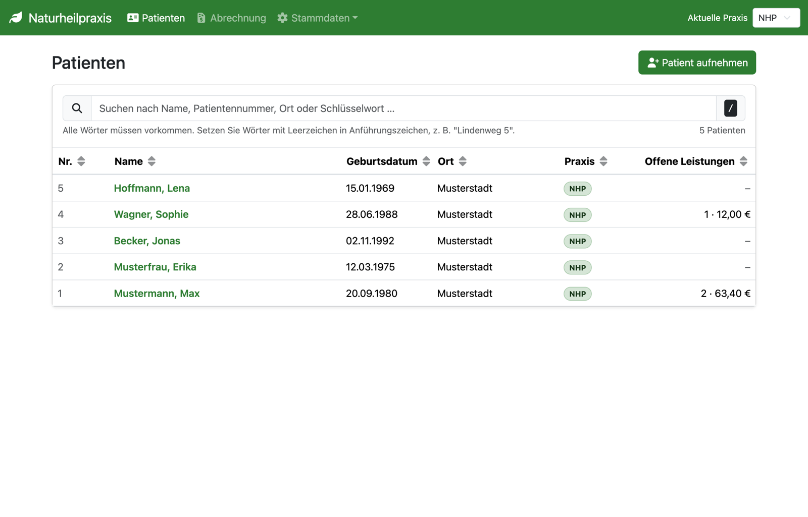
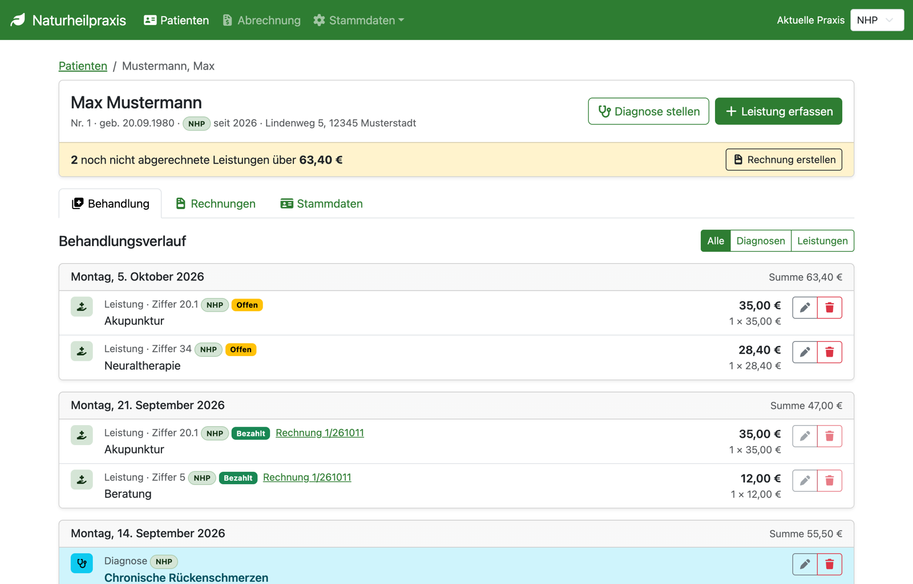
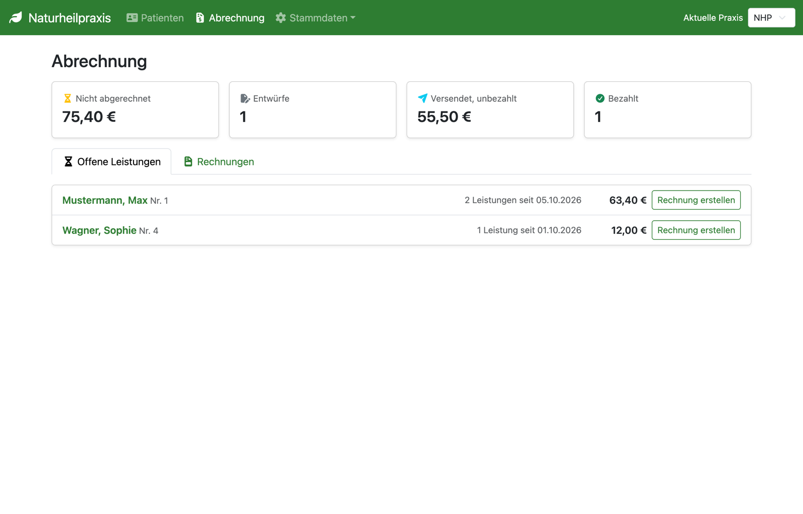
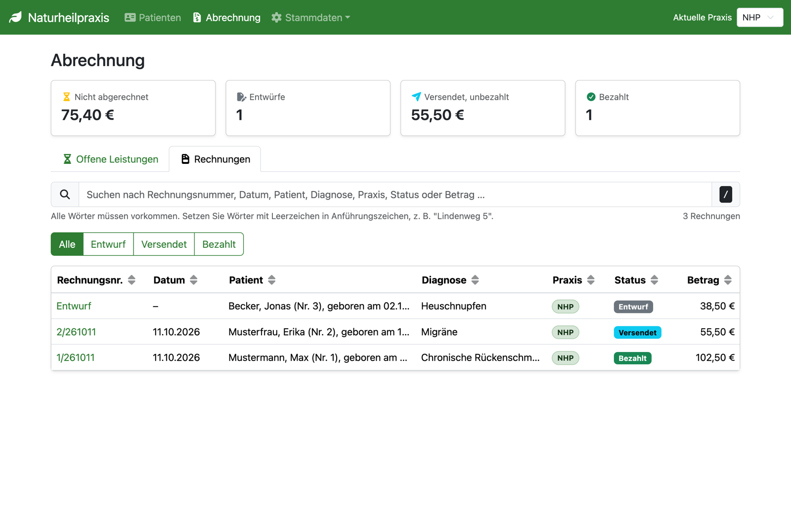
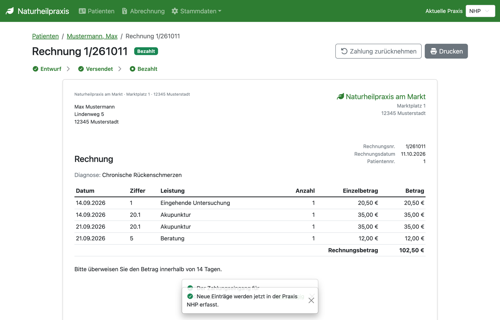
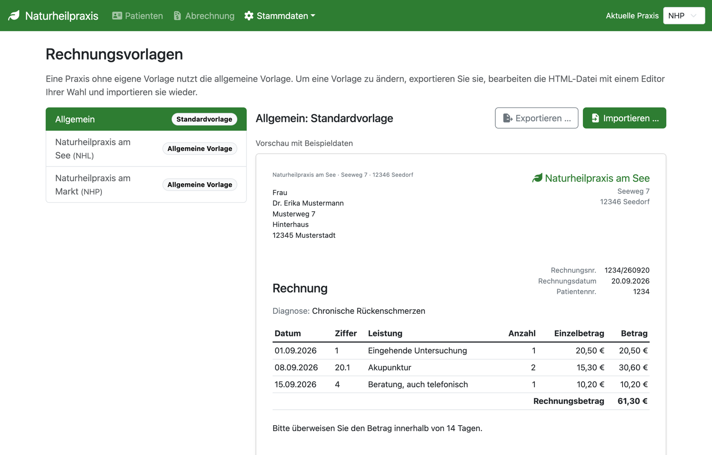

# Naturheilpraxis

**Naturheilpraxis erfasst Diagnosen und Leistungen Ihrer Patienten und macht
daraus mit wenigen Klicks eine fertige Rechnung.** Die Anwendung richtet sich an
Heilpraktikerinnen und Heilpraktiker, die eine oder mehrere Praxen führen. Vom
ersten Termin bis zum Zahlungseingang behalten Sie jederzeit den Überblick, was
erbracht, abgerechnet und bezahlt ist.

## Funktionen

- **Patientenverwaltung:** Patienten aufnehmen, Stammdaten pflegen und über eine
  Schnellsuche nach Name, Nummer, Ort oder Schlüsselwort finden.
- **Behandlungsverlauf:** Diagnosen und Leistungen tageweise erfassen, mit
  Gebührenziffer, Anzahl und Betrag sowie einer Tagessumme.
- **Rechnungen:** Offene Leistungen auswählen, Entwurf prüfen, als versendet
  markieren, drucken und den Zahlungseingang erfassen.
- **Abrechnungsübersicht:** Kennzahlen zu nicht abgerechneten Leistungen,
  Entwürfen, offenen und bezahlten Rechnungen auf einen Blick.
- **Mehrere Praxen:** Jede Praxis hat ihr Kürzel, ihre Anschrift und ihren
  Rechnungstext; neue Einträge landen in der gerade gewählten Praxis.
- **Eigene Rechnungsvorlagen:** Die Vorlage als HTML exportieren, frei gestalten
  und je Praxis wieder importieren.
- **Gebührenverzeichnis:** Gebührenziffern mit Bezeichnung und Betrag zentral
  hinterlegen.

## Vorteile auf einen Blick

- **Nichts geht verloren:** Jede Leistung ist als offen, abgerechnet oder
  bezahlt markiert und mit ihrer Rechnung verknüpft.
- **Rechnung in Minuten:** Diagnose, Rechnungstext und offene Leistungen werden
  vorbelegt, Sie prüfen nur noch den Entwurf.
- **Klarer Status:** Jede Rechnung durchläuft sichtbar die Schritte Entwurf,
  Versendet und Bezahlt; ein Schritt lässt sich zurücknehmen.
- **Ihre Daten bleiben bei Ihnen:** Alles liegt in einer lokalen Datenbankdatei
  auf Ihrem Rechner.
- **Per Tastatur bedienbar:** Suchfelder lassen sich mit / ansteuern, alle
  Dialoge funktionieren ohne Maus.

## Installation

Naturheilpraxis ist eine Desktop-Anwendung für macOS, Windows und Linux.

Laden Sie die Installationsdatei für Ihr Betriebssystem von den
[GitHub-Releases](https://github.com/falkoschumann/naturheilpraxis/releases) des
Projekts herunter:

- **macOS:** Die DMG-Datei öffnen und die Anwendung in den Ordner „Programme“
  ziehen.
- **Windows:** Den Installer ausführen und den Anweisungen folgen.
- **Linux:** Die AppImage-Datei ausführbar machen und starten.

Den Speicherort der Datenbankdatei wählen Sie beim ersten Start und können ihn
jederzeit ändern. Alle Daten und Druckvorlagen werden in einer Datei gesichert.

## Verwendung

So kommen Sie von der ersten Eingabe bis zur bezahlten Rechnung:

1. Praxis mit Kürzel, Anschrift und Rechnungstext anlegen.
2. Gebührenziffern mit Bezeichnung und Betrag im Gebührenverzeichnis
   hinterlegen.
3. Patienten aufnehmen und Stammdaten pflegen.
4. Diagnosen und Leistungen im Behandlungsverlauf erfassen.
5. In der Abrechnung offene Leistungen auswählen und den Rechnungsentwurf
   prüfen.
6. Die Rechnung als versendet markieren, drucken oder als PDF ausgeben und den
   Zahlungseingang erfassen.

Alle Screenshots zeigen fiktive Beispieldaten.

### Patienten

Alle Patienten in einer sortier- und durchsuchbaren Liste, mit offenen
Leistungen je Patient.

### Behandlungsverlauf

Diagnosen und Leistungen nach Tagen gruppiert; der gelbe Hinweis zeigt, was noch
abzurechnen ist.

### Abrechnung

Vier Kennzahlen und alle Patienten mit offenen Leistungen, je mit eigener
Schaltfläche zum Abrechnen.

### Rechnungen

Alle Rechnungen nach Status gefiltert und durchsuchbar.

### Rechnung

Die fertige Rechnung mit Fortschritt von Entwurf über Versendet bis Bezahlt.

### Rechnungsvorlagen

Vorlagen je Praxis, mit Vorschau mittels Beispieldaten.

## Technische Daten und Lizenz

| Merkmal          | Angabe                                                  |
| ---------------- | ------------------------------------------------------- |
| Anwendungsart    | Desktop-Anwendung, läuft offline                        |
| Betriebssysteme  | macOS (DMG), Windows (Installer), Linux (AppImage)      |
| Datenhaltung     | Eine lokale Datenbankdatei, frei wählbarer Speicherort  |
| Rechnungsausgabe | Druck bzw. PDF über den Druckdialog des Betriebssystems |
| Lizenz           | MIT, quelloffen                                         |
