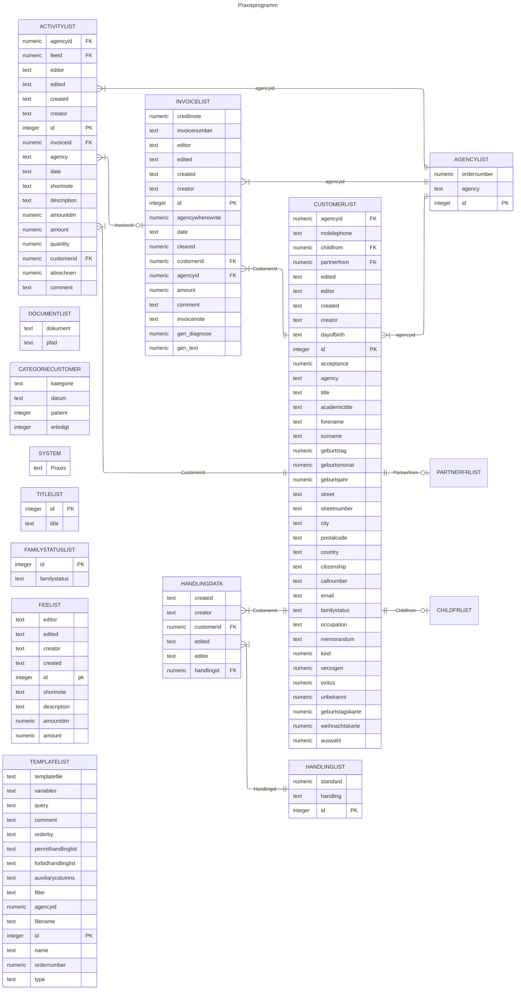
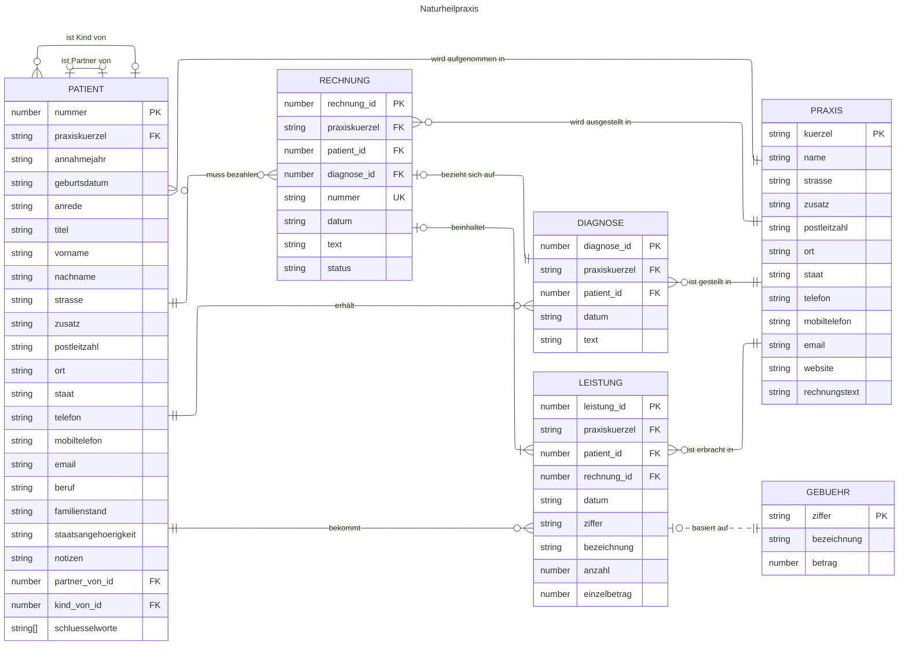

# Naturheilpraxis

[Architecture Communication Canvas](https://html-preview.github.io/?url=https://github.com/falkoschumann/naturheilpraxis/blob/main/docs/acc.html)

## Rechnungsvorlage

Die App erzeugt eine Rechnung aus einer Rechnungsvorlage. Ohne eigene Vorlage
nutzt sie die mitgelieferte Standardvorlage
`apps/desktop/src/main/ui/rechnungsvorlage.html`.

Eine Rechnungsvorlage ist eine einzelne HTML-Datei. Sie bringt alles mit, was
sie braucht:

- CSS steht in einem `<style>`-Element oder im Attribut `style`.
- Bilder sind eingebettetes SVG oder Data-URIs (`data:image/png;base64,…`),
  Schriften ebenfalls Data-URIs.
- Skripte laufen nicht. Externe Dateien wie Bilder, Schriften oder Stylesheets
  aus dem Netz oder von der Festplatte werden nicht geladen.

Platzhalter folgen [Mustache](https://mustache.github.io/mustache.5.html):

- `{{name}}` setzt einen Wert ein, maskiert für HTML.
- `{{#name}}…{{/name}}` zeigt den Inhalt nur, wenn der Wert vorhanden ist, und
  wiederholt ihn für jedes Element einer Liste. Innerhalb steht `{{.}}` für den
  Wert selbst.
- `{{^name}}…{{/name}}` zeigt den Inhalt nur, wenn der Wert fehlt.
- Mit Punkten wird auf verschachtelte Werte zugegriffen, etwa
  `{{praxis.anschrift.ort}}`.

Datumsangaben und Beträge sind bereits formatiert, etwa `11.10.2026` und
`51,10 €`. Mit _optional_ gekennzeichnete Werte können fehlen.

| Platzhalter                     | Bedeutung                                              |
| ------------------------------- | ------------------------------------------------------ |
| `rechnungsnummer`               | Rechnungsnummer, optional, fehlt beim Entwurf          |
| `rechnungsdatum`                | Rechnungsdatum, optional, fehlt beim Entwurf           |
| `entwurf`                       | wahr, solange die Rechnung ein Entwurf ist             |
| `status`                        | `entwurf`, `versendet` oder `bezahlt`                  |
| `praxis.name`                   | Name der Praxis                                        |
| `praxis.anschrift.strasse`      | Straße und Hausnummer der Praxis                       |
| `praxis.anschrift.zusatz`       | Adresszusatz der Praxis, optional                      |
| `praxis.anschrift.postleitzahl` | Postleitzahl der Praxis                                |
| `praxis.anschrift.ort`          | Ort der Praxis                                         |
| `praxis.anschrift.staat`        | Staat der Praxis, optional                             |
| `praxis.kontakt.telefon`        | Telefon der Praxis, optional                           |
| `praxis.kontakt.mobiltelefon`   | Mobiltelefon der Praxis, optional                      |
| `praxis.kontakt.fax`            | Fax der Praxis, optional                               |
| `praxis.kontakt.email`          | E-Mail der Praxis, optional                            |
| `praxis.kontakt.website`        | Website der Praxis, optional                           |
| `patient.patientennummer`       | Patientennummer                                        |
| `patient.anrede`                | Anrede, optional, etwa „Herr“                          |
| `patient.titel`                 | Titel, optional, etwa „Dr.“                            |
| `patient.vorname`               | Vorname                                                |
| `patient.nachname`              | Nachname                                               |
| `patient.name`                  | Titel, Vorname und Nachname, etwa „Dr. Max Mustermann“ |
| `patient.geburtsdatum`          | Geburtsdatum                                           |
| `patient.anschrift`             | Anschrift des Patienten wie bei der Praxis, optional   |
| `diagnosetext`                  | Diagnose auf der Rechnung                              |
| `rechnungstext`                 | Text unter den Positionen, etwa das Zahlungsziel       |
| `positionen`                    | Liste der Leistungen, aufsteigend nach Datum           |
| `positionen` → `datum`          | Datum der Leistung                                     |
| `positionen` → `ziffer`         | Gebührenziffer                                         |
| `positionen` → `bezeichnung`    | Bezeichnung der Leistung                               |
| `positionen` → `anzahl`         | Anzahl                                                 |
| `positionen` → `einzelbetrag`   | Einzelbetrag                                           |
| `positionen` → `betrag`         | Anzahl mal Einzelbetrag                                |
| `gesamtbetrag`                  | Summe der Beträge aller Positionen                     |

Beispiel für die Positionen:

```html
<table>
  {{#positionen}}
  <tr>
    <td>{{datum}}</td>
    <td>{{bezeichnung}}</td>
    <td>{{betrag}}</td>
  </tr>
  {{/positionen}}
</table>
<p>Rechnungsbetrag: {{gesamtbetrag}}</p>
```

## Migration

### Legacy Datenbankschema

Das folgende Schema dokumentiert die aktuelle SQLite-Datenbank.



### Schema der Zieldatenbank

Das folgende Schema beschreibt das Ziel als Basis für das Domain Model.


